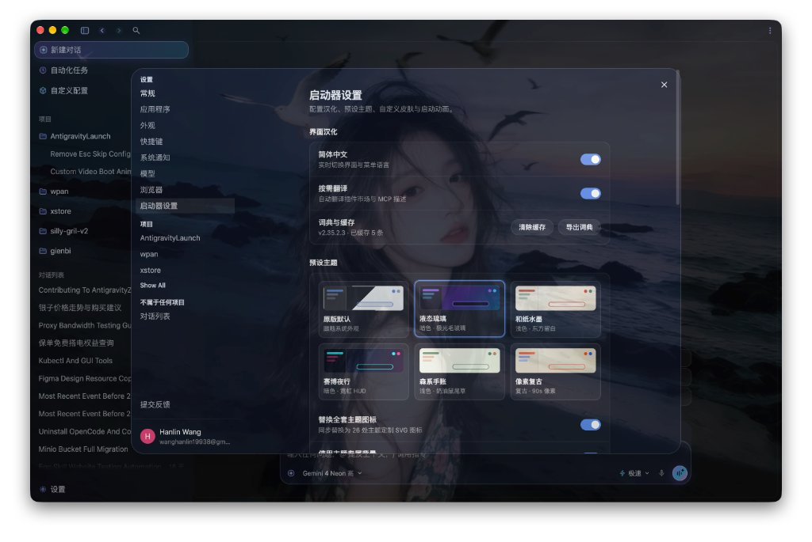
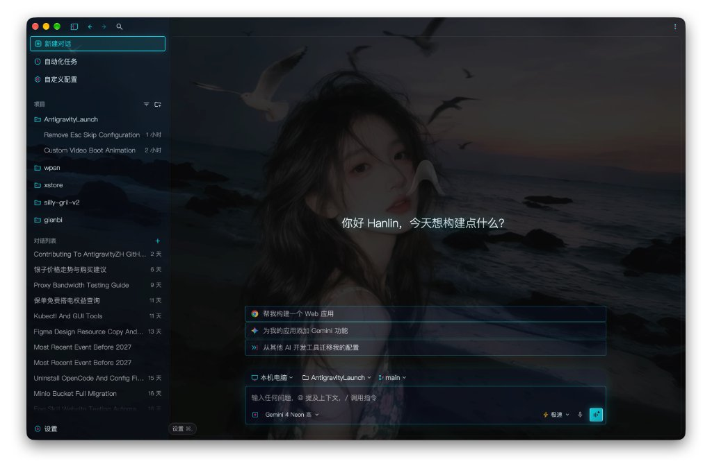
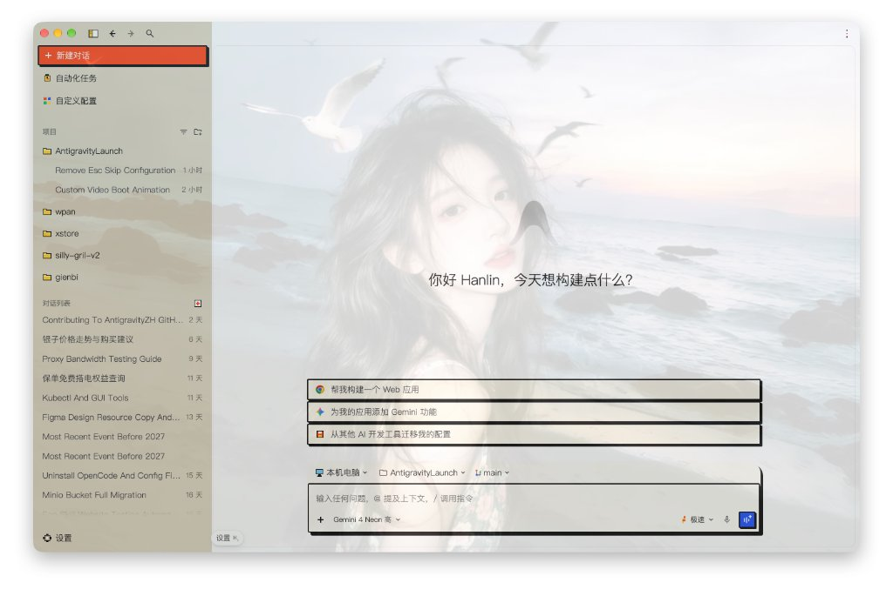
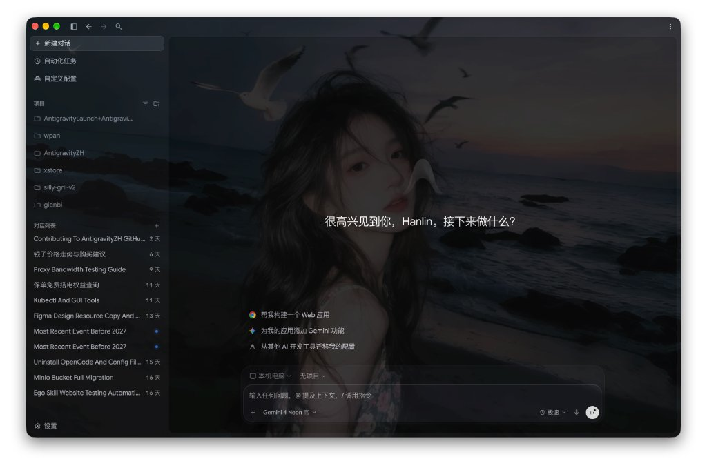

# AntigravityZH

给 **Google Antigravity** 用的轻量启动器，打开即用，不修改原版程序，不影响官方更新。

通过它启动 Antigravity 后，可以在 **设置 → 浏览器下方** 看到新增的 **「启动器设置」**，随时配置汉化、预设主题、自定义皮肤与启动动画。

---

## 效果展示

### 自定义启动动画

[点击观看启动动画演示视频（MP4）](https://catx.top:19003/share/%E5%8F%8D%E9%87%8D%E5%8A%9B.mp4)

### 启动器设置界面（液态琉璃）



### 预设主题 + 自定义皮肤

#### 赛博夜行（暗色 · 霓虹 HUD）



#### 像素复古（复古 · 90s 像素）



#### 原版默认 + 自定义皮肤



---

## 目前支持的功能

- **一键汉化**：界面、菜单、设置页转为简体中文，支持按需翻译插件市场与 MCP 描述，可在设置里随时切回英文，不用重启。
- **预设主题**：内置 5 套完整主题（液态琉璃、和纸水墨、赛博夜行、森系手账、像素复古），支持同步替换 26 处主题定制 SVG 图标与氛围背景。
- **自定义皮肤**：挑选自己喜欢的本地图片当背景（支持 PNG / JPG / WebP / BMP / AVIF），可自由调节毛玻璃浓度、透明度、遮罩、模糊度和覆盖区域，也支持浮窗边看边调。
- **自定义启动动画**：支持选择本地视频或动图（MP4 / WebM / MOV / GIF / WebP）作为启动动画，可自定义画面适配、结束时机、最短展示时长与音量。
- **不影响原版**：不改动 Antigravity 任何文件。想用原版时直接打开官方 Antigravity 即可；启动器在拉起应用后自动退出，不占后台内存。

---


## 怎么使用

前往右侧 **Releases** 页面，按你的电脑系统下载对应文件：


| 系统                        | 下载文件                                  | 说明          |
| ------------------------- | ------------------------------------- | ----------- |
| Windows (64 位)            | `AntigravityZH-windows-amd64.exe` | 双击直接运行      |
| macOS (M1 / M2 / M3 / M4) | `AntigravityZH-darwin-arm64.dmg`  | 打开后拖进「应用程序」 |
| macOS (Intel 芯片)          | `AntigravityZH-darwin-amd64.dmg`  | 打开后拖进「应用程序」 |


### Windows 用户

1. 下载 `AntigravityZH-windows-amd64.exe`，放到任意文件夹（也可以发送到桌面快捷方式）。
2. 双击运行即可启动 Antigravity。


### macOS 用户

1. 双击打开对应芯片的 `.dmg` 文件，把 `AntigravityZH.app` 拖进 `Applications`**（应用程序）**。
2. 首次打开如果系统提示「无法验证开发者」或「已损坏」，打开「终端」粘贴运行一次下面这行命令即可：
  ```bash
   xattr -cr /Applications/AntigravityZH.app
  ```
3. 之后直接在启动台或应用程序里打开 **AntigravityZH** 即可。


### 在哪里修改配置？

启动后，打开 Antigravity 左下角的 **设置**，在左侧列表 **「浏览器」** 下方点击 **「启动器设置」**（也可以在顶部菜单 `Antigravity → 启动器设置...` 打开），即可直接调整汉化、预设主题、皮肤与启动动画。

---


## 常见问题

- **如果 Antigravity 已经打开了怎么办？**
再次运行启动器时会弹出提示，点击确认即可自动重启并加载启动器功能。
- **Antigravity 官方更新后会坏掉吗？**
不会。启动器不修改任何官方文件，更新后依然可以直接用。
- **怎么恢复纯原版？**
直接打开原来的 Antigravity 图标就行，不用卸载或清理任何东西。

